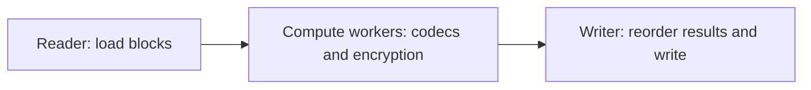

# SFC — Simple Files Compressor

  

[简体中文](README.md) | **English**

SFC is a Windows desktop archiving tool built with C++20 and Qt 6. It combines files and directories into a custom `.sy` archive and supports Huffman compression, AES-128-CTR encryption and directory restoration.

A shared pipeline combines codecs, block-based concurrency and filesystem handling across four archive modes. The GUI provides file operations and progress feedback. The current version is 2.2.1 and targets Windows 10+ x64.

## Project Features

| Feature | Content |
|---|---|
| Multiple files and directories | Mixed file and folder inputs, drag and drop, duplicate-path filtering and directory preservation |
| Four processing modes | Huffman compression, compression with encryption, encryption only and packing only; extraction detects the archive mode |
| Path and link restoration | Support for Chinese filenames, long paths, Windows symbolic links and junctions |
| Progress and logs | Overall and per-file progress, processing logs, and Chinese and English UI |

### Compression, Encryption and Archive Format

The canonical Huffman codec includes bit packing, code-length reconstruction and table-based decoding. The encryption module uses Windows CNG for AES-128-CTR keystream generation, random IVs, block encryption and decryption, and directory-region encryption.

A strategy factory composes compression and encryption interfaces. Huffman Only compresses data; Huffman + AES compresses before encryption; AES Only encrypts file contents and directory information; Pack Only combines the inputs into an archive. Directory information is stored in the archive and used to restore files and folders during extraction.

### Block Processing and Buffer Reuse

Compression and extraction share a three-stage pipeline that overlaps disk I/O with codec computation:

Data is processed in 8 MiB blocks, with the worker count defaulting to the logical CPU count. A buffer pool bounds the blocks in flight and provides backpressure. A result-ordering stage restores archive write order after parallel processing, keeping memory use bounded by buffering and concurrency.

Archive tasks run on a Qt worker thread. Signals carry progress, logs and results back to the UI, keeping file processing from blocking interface interaction.

### Verification and Performance

Six unit tests and three end-to-end round-trip cases cover codecs, the buffer pool, queues, result ordering and archive I/O. Round-trip cases compare every file byte for byte, with samples covering Chinese filenames, long paths and block boundaries.

Measured throughput is **254.3 MiB/s** for compression and **325.1 MiB/s** for extraction on an AMD Ryzen 7 8845H with 16 compute workers, using Huffman + AES on a project tree of **13.47 GiB across 45,390 files**. These figures use a v2.2.1 Release build with `-O3 -DNDEBUG` and LTO and include disk I/O. Conditions and measurement batches are documented in [engineering practice](Y_MultipleAgentWorkflow/Engineering/工程实践.md#10-性能画像).

## Getting Started

The GUI supports adding files or directories, setting an output location and selecting a processing mode. Extraction accepts a `.sy` archive; encrypted archives require the original passphrase. Dependencies, building, running and testing are covered in the [build notes](DevFiles/构建说明.md), in Chinese.

Extracting archives into an empty directory is recommended. Encryption provides content confidentiality; integrity and passphrase-derivation boundaries are documented in [engineering practice](Y_MultipleAgentWorkflow/Engineering/工程实践.md#13-威胁模型). Restoring symbolic links requires Developer Mode or the relevant privilege.

## Documentation

| Document | Content |
|---|---|
| [System documentation index](Y_MultipleAgentWorkflow/Router.md) | Architecture, archives, codecs, pipelines and UI |
| [System and terminology](Y_MultipleAgentWorkflow/Architecture/系统与术语.md) | Module layers, dependency direction and end-to-end data flow |
| [Archive format](Y_MultipleAgentWorkflow/ArchiveFormat/归档格式.md) | Archive layout, directory information and path restoration |
| [Concurrent pipeline](Y_MultipleAgentWorkflow/Pipeline/流水线.md) | Block scheduling, result ordering and thread shutdown |
| [Codec internals](Y_MultipleAgentWorkflow/Codec/编解码内核.md) | Huffman and AES implementation and boundaries |
| [Engineering practice](Y_MultipleAgentWorkflow/Engineering/工程实践.md) | Testing, performance measurements and security boundaries |

The reference documents above are in Chinese.

Documentation routing and concurrent agent work use [Y_MultipleAgentWorkflow](https://github.com/KAIDO-YONAGI/Y_MultipleAgentWorkflow), a workflow I developed and maintain.

## Credits and License

Project code is licensed under [GPL-3.0](LICENSE). Qt and other resource licenses and attribution are listed in [THIRD_PARTY_NOTICES.md](THIRD_PARTY_NOTICES.md).
