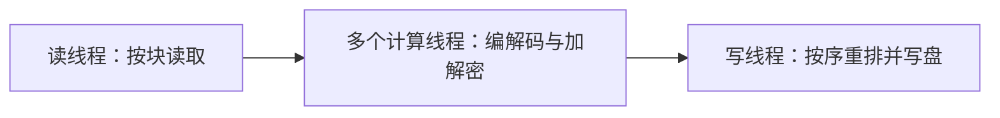

# SFC — Simple Files Compressor

  

**简体中文** | [English](README.en.md)

SFC 是基于 C++20 与 Qt 6 的 Windows 图形化归档工具，可将多个文件与目录打包为自定义 `.sy` 归档，支持 Huffman 压缩、AES-128-CTR 加密与目录结构还原。

编解码、分块并发和文件系统处理通过统一流水线组合成四种归档模式，图形界面提供文件操作与进度反馈。当前版本为 2.2.1，运行平台为 Windows 10+ x64。

## 项目内容

| 功能 | 内容 |
|---|---|
| 多文件与目录归档 | 混合添加文件和文件夹、拖放输入与重复路径过滤，保留目录层级 |
| 四种处理模式 | Huffman 压缩、压缩加密、仅加密与仅打包，解压时自动识别归档模式 |
| 路径与链接还原 | 支持中文路径、超长路径、Windows 符号链接与 Junction |
| 进度与日志 | 整体和当前文件进度、处理日志以及中英文界面 |

### 压缩、加密与归档格式

压缩内核采用 canonical Huffman 编解码，包含位打包、码长表重建和主表解码。加密模块基于 Windows CNG 实现 AES-128-CTR 密钥流生成、随机 IV、分块加解密与目录区加密。

策略工厂组合压缩与加密接口：Huffman Only 负责压缩，Huffman + AES 先压缩再加密，AES Only 加密文件内容与目录信息，Pack Only 将输入合并为一个归档。归档保存目录信息，解压时据此恢复文件与目录结构。

### 分块并发与内存复用

压缩和解压共用读、计算、写三段流水线，使磁盘 I/O 与编解码计算并行执行：

数据按 8 MiB 分块处理，计算线程数默认为 CPU 逻辑核数。缓冲池限制在途数据块数量并形成背压；结果定序模块将并发完成的块恢复为归档写入顺序，内存占用受缓冲和并发规模约束。

归档任务在 Qt 工作线程中执行，进度、日志和结果通过信号传回界面，避免文件处理阻塞界面交互。

### 验证与性能

6 个单元测试与 3 个端到端往返用例覆盖算法、缓冲池、队列、结果重排和归档读写。往返用例逐文件逐字节比对，样本涵盖中文路径、长路径与分块边界。

在 AMD Ryzen 7 8845H 上，以 16 个计算线程和 Huffman + AES 模式处理 **13.47 GiB、45,390 个文件**的工程树，压缩吞吐为 **254.3 MiB/s**，解压吞吐为 **325.1 MiB/s**。该组数据来自 v2.2.1 的 Release 构建，采用 `-O3 -DNDEBUG` 与 LTO，并包含磁盘 I/O；测量条件与批次说明见[工程实践](Y_MultipleAgentWorkflow/Engineering/工程实践.md#10-性能画像)。

## 使用入口

图形界面支持添加文件与目录、设置输出位置和选择处理模式；解压时选择 `.sy` 归档，加密归档使用创建时的口令。依赖配置、构建、运行与测试见[构建说明](DevFiles/构建说明.md)。

建议将归档解压到空目录。加密提供内容机密性，完整性与口令派生边界见[工程实践](Y_MultipleAgentWorkflow/Engineering/工程实践.md#13-威胁模型)；恢复符号链接需要开发者模式或相应权限。

## 文档导航

| 文档 | 内容 |
|---|---|
| [项目系统索引](Y_MultipleAgentWorkflow/Router.md) | 按架构、归档、编解码、流水线与界面查阅系统文档 |
| [系统与术语](Y_MultipleAgentWorkflow/Architecture/系统与术语.md) | 模块分层、依赖方向与端到端数据流 |
| [归档格式](Y_MultipleAgentWorkflow/ArchiveFormat/归档格式.md) | 归档布局、目录信息与路径还原规则 |
| [并发流水线](Y_MultipleAgentWorkflow/Pipeline/流水线.md) | 分块调度、结果重排与线程关闭协议 |
| [编解码内核](Y_MultipleAgentWorkflow/Codec/编解码内核.md) | Huffman 与 AES 的实现及边界 |
| [工程实践](Y_MultipleAgentWorkflow/Engineering/工程实践.md) | 测试口径、性能画像与安全边界 |

文档路由与多 Agent 并发协作采用我开发并维护的 [Y_MultipleAgentWorkflow](https://github.com/KAIDO-YONAGI/Y_MultipleAgentWorkflow)。

## 致谢与许可

项目代码采用 [GPL-3.0](LICENSE) 许可。Qt 与其他资源的许可、来源见 [THIRD_PARTY_NOTICES.md](THIRD_PARTY_NOTICES.md)。
